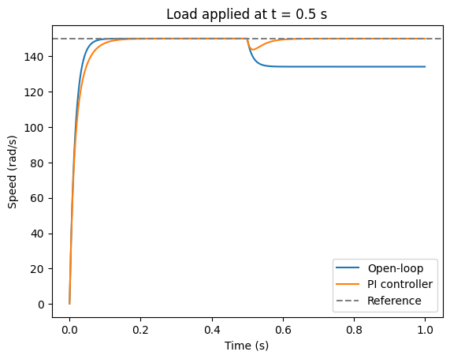

# DC Motor Speed Control: Open-Loop vs. PI

A simple Python simulation of a small DC motor. A load torque is applied
at t = 0.5 s, and open-loop voltage control is compared with a PI
speed controller.

## Model

    L di/dt = V - R*i - Ke*w
    J dw/dt = Kt*i - B*w - T_load

The equations are integrated with the Euler method (dt = 0.1 ms).
Motor parameters are example values for a small 12 V motor,
not measurements of a real motor.

## Controller

- Open-loop: a fixed voltage that gives 150 rad/s with no load.
- PI: V = Kp*e + Ki*integral(e), limited to +-12 V.
  Kp = 0.05, Ki = 2.5 (chosen by trial).

## Results

| Case | Speed drop after load | Final speed error |
|---|---|---|
| Open-loop | 15.9 rad/s | 15.9 rad/s |
| PI | 6.2 rad/s | 0 |

The PI controller removes the steady-state error that open-loop
control leaves after the load is applied.

## Limitations

- Simulation only, no hardware.
- No PWM switching, sensor noise, or nonlinear friction.
- Gains were not systematically optimized.

## Run

    pip install numpy matplotlib
    python dc_motor_pi.py
